# Data Model

The wiki4ai database is a single **PostgreSQL 16** instance running the **pgvector** extension (compose image `pgvector/pgvector:pg16`). The schema is managed exclusively by **Flyway** migrations V1–V25 (`backend/src/main/resources/db/migration/`); in the postgres profile Hibernate runs with `ddl-auto: validate`, so the JPA entities and the migrations must always agree.

All tables use `BIGSERIAL` identity primary keys and `TIMESTAMP` (local, no timezone) audit columns set by JPA lifecycle callbacks (`@PrePersist`/`@PreUpdate`).

## Entity-relationship diagram

```mermaid
erDiagram
    USERS ||--o| REFRESH_TOKENS : "at most one active"
    USERS ||--o{ API_TOKENS : "owns named tokens"
    USERS ||--o{ VAULT_ENTRIES : "stores encrypted entries"
    USERS }o--o{ PROJECTS : "grants via project_permissions"
    USERS ||--o{ CALENDAR_EVENTS : "creates events"
    EVENT_ENTITY_TYPES ||--o{ CALENDAR_EVENTS : "classifies"
    PROJECTS |o--|{ PROJECTS : "parent_id self-reference"
    PROJECTS ||--o{ DOCUMENTS : "contains"
    DOCUMENTS }o--o{ DOCUMENTS : "wiki links (document_links)"
    USERS |o--o{ ACTORS : "owns registered actors"
    PROJECTS ||--o{ PROJECT_ACTORS : "assigns actors"
    ACTORS ||--o{ PROJECT_ACTORS : "holds roles in"
    ACTORS |o--o{ API_TOKENS : "tokens act as"
    PROJECTS ||--o{ WORK_ITEMS : "tracks work"
    WORK_ITEMS |o--o{ WORK_ITEMS : "parent_id self-reference"
    ACTORS |o--o{ WORK_ITEMS : "claims / authored"
    WORK_ITEMS ||--o{ WORK_ITEM_EVENTS : "append-only audit"
    WORK_ITEMS ||--o{ WORK_ITEM_COMMENTS : "append-only discussion"
    ACTORS |o--o{ WORK_ITEM_EVENTS : "attributed to"
    ACTORS |o--o{ WORK_ITEM_COMMENTS : "authored"
    RESOURCES ||--o{ RESERVATIONS : "capacity held by"
    ACTORS |o--o{ RESERVATIONS : "holds"

    USERS {
        bigint id PK
        varchar username UK
        varchar email UK
        varchar password "BCrypt hash"
        varchar role "USER or ADMIN, default USER"
        timestamp created_at
        timestamp updated_at
        varchar vault_master_password_hash "nullable, PBKDF2"
        varchar vault_salt "nullable, Base64"
    }

    PROJECTS {
        bigint id PK
        varchar name UK
        varchar description "max 1000 chars"
        varchar slug UK
        bigint parent_id FK "self-ref, nullable = root, ON DELETE CASCADE"
        bigint owner_id FK "nullable (V14)"
        varchar visibility "public or private, default public (V14)"
        timestamp created_at
        timestamp updated_at
    }

    DOCUMENTS {
        bigint id PK
        varchar title
        text content "markdown"
        varchar slug "unique per project"
        bigint project_id FK "NOT NULL"
        vector embedding "vector(1024), nullable, HNSW index"
        bigint version "NOT NULL default 0, JPA @Version"
        bigint owner_id FK "nullable (V14)"
        varchar visibility "public or private, default public (V14)"
        bigint created_by_actor_id FK "nullable, actor attribution (V19)"
        bigint updated_by_actor_id FK "nullable, actor attribution (V19)"
        timestamp created_at
        timestamp updated_at
    }

    EVENT_ENTITY_TYPES {
        bigint id PK
        varchar name UK "max 100 chars"
        varchar color "nullable hex, max 20"
        timestamp created_at
    }

    CALENDAR_EVENTS {
        bigint id PK
        varchar title "max 255 chars"
        text description
        bigint event_type_id FK "NOT NULL"
        date event_date "NOT NULL"
        time start_time "nullable = all-day"
        time end_time "nullable"
        varchar visibility "public or private, default public"
        bigint created_by FK "NOT NULL, FK to users"
        timestamp created_at
        timestamp updated_at
    }

    DOCUMENT_LINKS {
        bigint source_document_id PK "composite PK with target"
        bigint target_document_id FK "FK to documents, part of composite PK"
    }

    PROJECT_PERMISSIONS {
        bigint id PK
        bigint project_id FK
        bigint user_id FK "unique per project+user"
    }

    REFRESH_TOKENS {
        bigint id PK
        bigint user_id UK "unique per user, FK to users"
        varchar token UK
        timestamp expires_at "nullable = infinite"
        timestamp created_at
    }

    API_TOKENS {
        bigint id PK
        bigint user_id FK
        varchar name
        varchar token_value "legacy JWT, nullable since V18"
        varchar token_hash UK "SHA-256 hex of w4a_ token, unique (V18)"
        varchar token_prefix "8-char display prefix, NULL for legacy (V18)"
        text scopes "space-separated, e.g. 'read write' (V18)"
        bigint actor_id FK "actor the token acts as, nullable (V18)"
        timestamp revoked_at "soft revoke (V18)"
        timestamp last_used_at "throttled write (V18)"
        timestamp expires_at "nullable = infinite"
        timestamp created_at
    }

    VAULT_ENTRIES {
        bigint id PK
        bigint user_id FK
        varchar title
        bytea username_encrypted
        bytea password_encrypted "NOT NULL"
        bytea notes_encrypted
        varchar url "plaintext, searchable"
        varchar group_path "plaintext, indexed"
        bytea iv "NOT NULL"
        timestamp created_at
        timestamp updated_at
    }

    ACTORS {
        bigint id PK
        varchar handle UK "lowercase-normalized, unique (V15)"
        varchar display_name
        varchar kind "agent or human or service (V15)"
        bigint owner_user_id FK "nullable, ON DELETE SET NULL (V15)"
        varchar system_label
        text capabilities
        varchar webhook_url
        timestamp last_seen_at
        varchar status "active or paused or archived (V15)"
        varchar presence_status "idle or working or busy (V17)"
        varchar presence_note "max 256 (V17)"
        bigint last_seen_event_id "inbox marker, nullable (V23)"
        timestamp created_at
        timestamp updated_at
    }

    PROJECT_ACTORS {
        bigint id PK
        bigint project_id FK "ON DELETE CASCADE (V16)"
        bigint actor_id FK "ON DELETE CASCADE (V16)"
        varchar role "viewer or worker or planner or admin (V16)"
        timestamp created_at
    }

    WORK_ITEMS {
        bigint id PK
        bigint project_id FK "ON DELETE CASCADE (V20)"
        varchar title "NOT NULL"
        text body
        varchar status "backlog default; 8 states (V20)"
        varchar priority "medium default (V20)"
        text labels "service-encoded list (V20)"
        bigint parent_id FK "self-ref, ON DELETE SET NULL (V20)"
        varchar external_ref UK "external tracker id, globally unique (V20)"
        bigint assignee_actor_id FK "claim triple (V20)"
        varchar claim_token "claim triple (V20)"
        timestamp lease_expires_at "claim triple (V20)"
        bigint created_by_user_id FK
        bigint created_by_actor_id FK "nullable (V20)"
        bigint updated_by_actor_id FK "nullable (V20)"
        timestamp created_at
        timestamp updated_at
        integer version "JPA @Version (V20)"
    }

    WORK_ITEM_EVENTS {
        bigint id PK
        bigint work_item_id FK "ON DELETE CASCADE (V21)"
        bigint actor_id FK "nullable, ON DELETE SET NULL (V21)"
        varchar event "append-only vocabulary (V21)"
        varchar from_status
        varchar to_status
        text payload "JSON, never the claim token (V21)"
        timestamp created_at
    }

    WORK_ITEM_COMMENTS {
        bigint id PK
        bigint work_item_id FK "ON DELETE CASCADE (V22)"
        bigint author_actor_id FK "nullable in schema, required via API (V22)"
        varchar kind "note status blocker result handoff decision (V22)"
        text body "NOT NULL (V22)"
        text payload "JSON, per-kind contract (V22)"
        timestamp created_at "no updated_at — immutable (V22)"
    }

    RESOURCES {
        bigint id PK
        varchar key UK "unique resource key (V25)"
        varchar name
        varchar kind "generic default (V25)"
        integer capacity "CHECK >= 1 (V25)"
        integer active_slots "CHECK 0..capacity (V25)"
        boolean enabled "default true (V25)"
        text metadata
        timestamp created_at
    }

    RESERVATIONS {
        bigint id PK
        bigint resource_id FK "ON DELETE CASCADE (V25)"
        bigint actor_id FK "nullable (V25)"
        bigint work_item_id FK "nullable (V25)"
        integer slots "CHECK >= 1, default 1 (V25)"
        varchar reason
        timestamp expires_at "NOT NULL, TTL (V25)"
        timestamp released_at "null = active (V25)"
        timestamp created_at
    }
```

## Entity reference

### users

| Column | Type | Constraints / notes |
|---|---|---|
| id | BIGSERIAL | PK |
| username | VARCHAR(255) | NOT NULL, **UNIQUE** |
| email | VARCHAR(255) | NOT NULL, **UNIQUE** |
| password | VARCHAR(255) | NOT NULL — BCrypt hash (never plaintext) |
| role | VARCHAR(255) | NOT NULL, `CHECK (role IN ('USER','ADMIN'))`, default `'USER'` (V2 adds it on pre-existing DBs) |
| created_at / updated_at | TIMESTAMP | NOT NULL, set by JPA callbacks (`created_at` updatable=false) |
| vault_master_password_hash | VARCHAR(255) | nullable (V7) — PBKDF2WithHmacSHA256, 100k iterations, client-computed |
| vault_salt | VARCHAR(255) | nullable (V8) — Base64 PBKDF2 salt, synced server-side so all of a user's clients derive the same vault key |

JPA entity `User` additionally holds a `@OneToOne(mappedBy="user", orphanRemoval)` to `RefreshToken`.

### projects

| Column | Type | Constraints / notes |
|---|---|---|
| id | BIGSERIAL | PK |
| name | VARCHAR(255) | NOT NULL, **UNIQUE** (checked in the service → 409 on create; renaming is allowed and never touches the slug) |
| description | VARCHAR(1000) | nullable |
| slug | VARCHAR(255) | NOT NULL, **UNIQUE** — generated once from the name at creation; stable across renames (WIKI4AI-54) |
| parent_id | BIGINT | nullable FK → `projects(id)` **ON DELETE CASCADE** (V9) + index `idx_projects_parent`; null = root project. Depth ≤ 5 and cycle prevention are enforced in the service layer |
| owner_id | BIGINT | nullable FK → `users(id)` (V14) — set when a private project is created; legacy rows stay NULL (= public) |
| visibility | VARCHAR(10) | NOT NULL DEFAULT `'public'`, `CHECK (visibility IN ('public','private'))` (V14) + index `idx_projects_visibility`; private = visible only to owner and ADMIN users |
| created_at / updated_at | TIMESTAMP | NOT NULL |

Self-referencing hierarchy: a project has at most one parent; deleting a project cascades to its subprojects (DB-level) and documents (JPA `CascadeType.ALL, orphanRemoval`).

### documents

| Column | Type | Constraints / notes |
|---|---|---|
| id | BIGSERIAL | PK |
| title | VARCHAR(255) | NOT NULL — changing it regenerates the slug |
| content | TEXT | nullable — Markdown source |
| slug | VARCHAR(255) | NOT NULL, **UNIQUE within a project** (`UNIQUE (project_id, slug)`); generated from the title with diacritic transliteration ("Úvod do Wiki4AI" → `uvod-do-wiki4ai`) |
| project_id | BIGINT | NOT NULL FK → `projects(id)` |
| embedding | vector(1024) | nullable (V10) — pgvector column, **intentionally not mapped on the JPA entity**; all vector I/O goes through native queries (`updateEmbedding`, `findTopByEmbeddingSimilarity`). HNSW index below |
| version | BIGINT | NOT NULL DEFAULT 0 (V11) — JPA `@Version`; Hibernate appends `WHERE version = ?` to every UPDATE and increments on success; concurrent stale commits fail → HTTP 409. Existing rows were backfilled to 0 |
| owner_id | BIGINT | nullable FK → `users(id)` (V14) — set when a private document is created; legacy rows stay NULL (= public) |
| visibility | VARCHAR(10) | NOT NULL DEFAULT `'public'`, `CHECK (visibility IN ('public','private'))` (V14) + index `idx_documents_visibility`; private = visible only to owner and ADMIN users |
| created_by_actor_id | BIGINT | nullable FK → `actors(id)` **ON DELETE SET NULL** (V19) — which actor (agent/human/service) wrote the document; an addition, not a replacement: `owner_id` stays untouched, and a legacy JWT request leaves the column NULL |
| updated_by_actor_id | BIGINT | nullable FK → `actors(id)` **ON DELETE SET NULL** (V19) — which actor last updated it; index `idx_documents_created_by_actor` on the create column |
| created_at / updated_at | TIMESTAMP | NOT NULL |

### document_links (N:M self-reference)

Composite PK `(source_document_id, target_document_id)`, both BIGINT NOT NULL FK → `documents(id)`. Populated server-side from `[[WikiLink]]` syntax extracted out of the Markdown on every create/update. Links are project-scoped by construction (the API rejects cross-project and self links). This table powers outgoing link lists, backlinks, and the graph view.

### project_permissions (+ element collection)

| Column | Type | Constraints / notes |
|---|---|---|
| id | BIGSERIAL | PK |
| project_id | BIGINT | NOT NULL FK → `projects(id)` |
| user_id | BIGINT | NOT NULL FK → `users(id)`; **UNIQUE (project_id, user_id)** |

The permission set itself is a JPA element collection stored in `project_permission_values (permission_id FK, permission SMALLINT)` — one row per granted level. Levels: `READ`, `CREATE`, `UPDATE`, `DELETE`, `MANAGE` (MANAGE implies all others). The creator of a project is auto-granted MANAGE; the ADMIN role bypasses these checks entirely.

### refresh_tokens

| Column | Type | Constraints / notes |
|---|---|---|
| id | BIGSERIAL | PK |
| user_id | BIGINT | NOT NULL, **UNIQUE** FK → `users(id)` — one active refresh token per user; each login/token call replaces it (delete + insert, striped-locked) |
| token | VARCHAR(255) | NOT NULL, UNIQUE — the JWT itself (`type=REFRESH`) |
| expires_at | TIMESTAMP | nullable since V4 — **null = infinite lifetime** |
| created_at | TIMESTAMP | NOT NULL |

### api_tokens

| Column | Type | Constraints / notes |
|---|---|---|
| id | BIGSERIAL | PK |
| user_id | BIGINT | NOT NULL FK → `users(id)` — a user can have many tokens; index `idx_api_tokens_user` |
| name | VARCHAR(255) | NOT NULL |
| token_value | VARCHAR(512) | **nullable since V18** — legacy rows keep the clear-text JWT and keep working; hashed tokens leave it NULL |
| token_hash | VARCHAR(64) | nullable, **UNIQUE** (V18) — SHA-256 hex digest of the `w4a_` plaintext; the auth filter looks tokens up by hash, so a revoked or deleted row revokes nothing silently — it revokes *immediately*. Postgres treats NULLs as distinct, so legacy rows coexist |
| token_prefix | VARCHAR(8) | nullable (V18) — the 8 characters after `w4a_`, shown in listings; `CHECK (token_prefix IS NULL OR char_length(token_prefix) = 8)`; NULL for legacy rows |
| scopes | TEXT | nullable (V18) — space-separated scope names (e.g. `read write`); no CHECK constraint, an unknown scope is a 400 from the service |
| actor_id | BIGINT | nullable FK → `actors(id)` **ON DELETE SET NULL** (V18) — the actor the token acts as; index `idx_api_tokens_actor`. Without it a credential names no actor and cannot claim/comment/reserve |
| revoked_at | TIMESTAMP | nullable (V18) — **soft revoke**: set = dead token (401 on use), row stays auditable |
| last_used_at | TIMESTAMP | nullable (V18) — written throttled (30 s window) so authentication never adds a write per request |
| expires_at | TIMESTAMP | nullable — null = never expires |
| created_at | TIMESTAMP | NOT NULL |

A hashed token is `w4a_` + 32 base62 characters from a secure random source; the plaintext is returned once at create/rotate and exists in the database only as its digest. See [[MCP Server]] for the token lifecycle (rotate, revoke, kill switch, per-token rate limit).

### actors (V15, extended by V17/V23)

| Column | Type | Constraints / notes |
|---|---|---|
| id | BIGSERIAL | PK |
| handle | VARCHAR(64) | NOT NULL, **UNIQUE** — globally unique, machine-friendly id (`agent-coder`); the service normalizes to lowercase so the DB constraint and the service duplicate check (409) agree |
| display_name | VARCHAR(128) | nullable |
| kind | VARCHAR(16) | NOT NULL DEFAULT `'agent'`, `CHECK (kind IN ('agent','human','service'))` |
| owner_user_id | BIGINT | nullable FK → `users(id)` **ON DELETE SET NULL** — removing the owner keeps the registry alive; index `idx_actors_owner` |
| system_label | VARCHAR(128) | nullable |
| capabilities | TEXT | nullable |
| webhook_url | VARCHAR(512) | nullable |
| last_seen_at | TIMESTAMP | nullable — heartbeat/last API call, throttled writes |
| status | VARCHAR(16) | NOT NULL DEFAULT `'active'`, `CHECK (status IN ('active','paused','archived'))` — **lifecycle** of the registry entry; index `idx_actors_status` |
| presence_status | VARCHAR(16) | NOT NULL DEFAULT `'idle'`, `CHECK (presence_status IN ('idle','working','busy'))` (V17) — **presence**, deliberately separate from lifecycle status |
| presence_note | VARCHAR(256) | nullable (V17) — free-text note sent with the heartbeat |
| last_seen_event_id | BIGINT | nullable (V23) — the inbox unseen marker: highest acknowledged `work_item_events.id`; **NULL = never read** (distinct from any number), no column default on purpose |

### project_actors (V16)

| Column | Type | Constraints / notes |
|---|---|---|
| id | BIGSERIAL | PK |
| project_id | BIGINT | NOT NULL FK → `projects(id)` **ON DELETE CASCADE**; index `idx_project_actors_project` |
| actor_id | BIGINT | NOT NULL FK → `actors(id)` **ON DELETE CASCADE**; index `idx_project_actors_actor` |
| role | VARCHAR(16) | NOT NULL DEFAULT `'viewer'`, `CHECK (role IN ('viewer','worker','planner','admin'))` — `admin` grants managing the project's actors (enforced in the service layer) |
| created_at | TIMESTAMP | NOT NULL |

One row per (project, actor): `UNIQUE (project_id, actor_id)` — a second assignment is a 409 (service pre-check + constraint for concurrent writes).

### work_items (V20)

| Column | Type | Constraints / notes |
|---|---|---|
| id | BIGSERIAL | PK |
| project_id | BIGINT | NOT NULL FK → `projects(id)` **ON DELETE CASCADE** |
| title | VARCHAR(255) | NOT NULL |
| body | TEXT | nullable |
| status | VARCHAR(16) | NOT NULL DEFAULT `'backlog'` — `backlog`/`ready`/`claimed`/`running`/`review`/`done`/`blocked`/`cancelled`; **no CHECK constraint**: the state machine lives in `WorkItemService`, and `claimed` is reachable only through the atomic claim |
| priority | VARCHAR(16) | NOT NULL DEFAULT `'medium'` |
| labels | TEXT | service-encoded list (same pattern as calendar/permission collections) |
| parent_id | BIGINT | nullable FK → `work_items(id)` **ON DELETE SET NULL** — removing a parent never removes children |
| external_ref | VARCHAR(128) | nullable, **UNIQUE** — id of the same item in an external tracker |
| assignee_actor_id / claim_token / lease_expires_at | BIGINT / VARCHAR(64) / TIMESTAMP | the **claim triple** written atomically by the claim endpoint: who holds the item, with which token, until when; index `idx_work_items_assignee` on `(assignee_actor_id, status)` |
| created_by_user_id | BIGINT | nullable FK → `users(id)` |
| created_by_actor_id / updated_by_actor_id | BIGINT | nullable FK → `actors(id)` **ON DELETE SET NULL** — actor attribution (same pattern as V19 on documents); a legacy JWT leaves them NULL |
| created_at / updated_at | TIMESTAMP | NOT NULL |
| version | INTEGER | NOT NULL DEFAULT 0 — JPA `@Version` optimistic locking |

Index `idx_work_items_project_status` on `(project_id, status)` serves the board queries.

### work_item_events (V21) — append-only audit

| Column | Type | Constraints / notes |
|---|---|---|
| id | BIGSERIAL | PK |
| work_item_id | BIGINT | NOT NULL FK → `work_items(id)` **ON DELETE CASCADE** — the timeline goes with the item |
| actor_id | BIGINT | nullable FK → `actors(id)` **ON DELETE SET NULL** — nullable on purpose: the lease reaper acts without a credential, and automatic events name the actor who *lost* the item |
| event | VARCHAR(32) | NOT NULL — `created` \| `status_changed` \| `claimed` \| `claim_released` \| `lease_extended` \| `lease_expired` \| `stale_claim_cleared` \| `deleted`; vocabulary owned by `WorkItemEventService`, no CHECK (single source of truth) |
| from_status / to_status | VARCHAR(16) | nullable — NULL where the event has no other side (`created` has no predecessor, `deleted` no successor) |
| payload | TEXT | nullable JSON — **never carries the claim token** (it is a secret that authorizes work) |
| created_at | TIMESTAMP | NOT NULL |

**Append-only, enforced twice**: the repository exposes no working mutating method and the entity's `@PreUpdate`/`@PreRemove` refuse the write; a PostgreSQL `BEFORE UPDATE` trigger refuses `UPDATE` at the database level too (DELETE is not trigger-refused so the `ON DELETE CASCADE` keeps working). Indexes: `(work_item_id, created_at)` and `(actor_id, created_at)`; V24 adds the keyset-pagination pair indexes `(work_item_id, id)` and `(actor_id, id)`. V21 also **backfills** two honest events per pre-existing work item (marked `{"backfilled":true}` in the payload) so metrics are non-zero from day one — and the metrics API reports the backfilled count separately.

### work_item_comments (V22) — append-only discussion

| Column | Type | Constraints / notes |
|---|---|---|
| id | BIGSERIAL | PK |
| work_item_id | BIGINT | NOT NULL FK → `work_items(id)` **ON DELETE CASCADE** |
| author_actor_id | BIGINT | nullable FK → `actors(id)` **ON DELETE SET NULL** in the schema (a row must survive the actor leaving the registry) but **required through the API** — the value comes exclusively from the verified credential, never the body |
| kind | VARCHAR(16) | NOT NULL — `note` \| `status` \| `blocker` \| `result` \| `handoff` \| `decision`; per-kind payload contracts enforced in `WorkItemCommentContract` (422 on violation), no CHECK constraint by the same reasoning as events |
| body | TEXT | **NOT NULL** — a comment with no text is not a comment (missing body = 400, contract violation = 422) |
| payload | TEXT | nullable JSON — the kind's structured detail (`Map<String,Object>` in the DTO) |
| created_at | TIMESTAMP | NOT NULL — **no `updated_at`**: a comment is immutable |

Same append-only double enforcement as events (repository + `BEFORE UPDATE` trigger). Indexes: `(work_item_id, kind)` — serves the `done`-invariant "does this item have a result comment" — and `(work_item_id, created_at)`; V24 adds `(work_item_id, id)` for keyset reads.

### resources (V25) — capacity ledger

| Column | Type | Constraints / notes |
|---|---|---|
| id | BIGSERIAL | PK |
| key | VARCHAR(64) | NOT NULL, **UNIQUE** — stable lookup key used by the API paths (a keyword in H2 2.x, mapped as a quoted identifier by the entity) |
| name | VARCHAR(128) | NOT NULL |
| kind | VARCHAR(32) | NOT NULL DEFAULT `'generic'` |
| capacity | INTEGER | NOT NULL DEFAULT 1, `CHECK (capacity >= 1)` |
| active_slots | INTEGER | NOT NULL DEFAULT 0, `CHECK (active_slots >= 0 AND active_slots <= capacity)` — the capacity invariant's last line of defense, mirrored as `@Check` on the entity so the H2 test schema enforces it too |
| enabled | BOOLEAN | NOT NULL DEFAULT TRUE — a disabled resource refuses new reservations (409) |
| metadata | TEXT | nullable |
| created_at | TIMESTAMP | NOT NULL |

### reservations (V25)

| Column | Type | Constraints / notes |
|---|---|---|
| id | BIGSERIAL | PK |
| resource_id | BIGINT | NOT NULL FK → `resources(id)` **ON DELETE CASCADE** |
| actor_id | BIGINT | nullable FK → `actors(id)` **ON DELETE SET NULL** — who holds the slots |
| work_item_id | BIGINT | nullable FK → `work_items(id)` **ON DELETE SET NULL** — what the capacity is for |
| slots | INTEGER | NOT NULL DEFAULT 1, `CHECK (slots >= 1)` |
| reason | VARCHAR(255) | nullable |
| expires_at | TIMESTAMP | **NOT NULL** — TTL; a scheduled reaper releases expired reservations so capacity always frees itself |
| released_at | TIMESTAMP | nullable — NULL = active; manual release is idempotent |
| created_at | TIMESTAMP | NOT NULL |

Indexes match the table's only two access patterns: `(resource_id, released_at)` (active reservations of one resource) and `(expires_at)` (the reaper's sweep).

### vault_entries

| Column | Type | Constraints / notes |
|---|---|---|
| id | BIGSERIAL | PK |
| user_id | BIGINT | NOT NULL FK → `users(id)`; index `idx_vault_user_id` |
| title | VARCHAR(255) | NOT NULL — plaintext (search/display) |
| username_encrypted | BYTEA | nullable — AES ciphertext, Base64 in DTOs |
| password_encrypted | BYTEA | NOT NULL |
| notes_encrypted | BYTEA | nullable |
| url | VARCHAR(2048) | **plaintext** by design (used for search/display, not encrypted) |
| group_path | VARCHAR(512) | plaintext folder path; index `idx_vault_group_path` |
| iv | BYTEA | NOT NULL — encryption initialization vector |
| created_at / updated_at | TIMESTAMP | NOT NULL |

End-to-end encryption: fields are encrypted **client-side** with a key derived from the user's master password (PBKDF2WithHmacSHA256, 100k iterations, per-user salt). The backend stores and returns only ciphertext — it never sees plaintext values.

### event_entity_types (V13)

| Column | Type | Constraints / notes |
|---|---|---|
| id | BIGSERIAL | PK |
| name | VARCHAR(100) | NOT NULL, **UNIQUE** — unique case-insensitively at the service level too (409 on duplicate create) |
| color | VARCHAR(20) | nullable — hex color used by the WebUI for event pills/blocks of this type |
| created_at | TIMESTAMP | NOT NULL |

Seeded by V13 with `Agent task` (`#4f8cff`) and `Pripomienka` (`#f59e0b`). Types are extensible at runtime (WebUI, REST, MCP); a type still referenced by events cannot be deleted (409 with the event count).

### calendar_events (V13)

| Column | Type | Constraints / notes |
|---|---|---|
| id | BIGSERIAL | PK |
| title | VARCHAR(255) | NOT NULL |
| description | TEXT | nullable |
| event_type_id | BIGINT | NOT NULL FK → `event_entity_types(id)`; index `idx_calendar_events_type` |
| event_date | DATE | NOT NULL — the calendar day; index `idx_calendar_events_date` |
| start_time | TIME | **nullable — NULL = all-day event** (date only); non-null = precise time (`HH:mm:ss`) |
| end_time | TIME | nullable — optional precise end time, meaningful only with `start_time` |
| visibility | VARCHAR(10) | NOT NULL DEFAULT `'public'`, `CHECK (visibility IN ('public','private'))`; private events are visible only to their creator and ADMIN users (others get 404 on detail/update/delete — existence not revealed) |
| created_by | BIGINT | NOT NULL FK → `users(id)`; index `idx_calendar_events_created_by` — the event's owner |
| created_at / updated_at | TIMESTAMP | NOT NULL |

The calendar is a **global** module: events are not project-scoped. Visibility semantics mirror V14's project/document visibility, but each event carries its own column. See [[Calendar]] for the WebUI views and API surface.

## Key design details

- **Optimistic locking (`documents.version`, V11).** New documents start at version 0; every successful update increments it. Clients may send `expectedVersion` on update for an explicit pre-check (409 with both versions before any change); the JPA `@Version` WHERE-clause is the backstop even when clients omit it. This is what makes concurrent WebUI autosave and MCP agent writes safe — stale writes 409 instead of overwriting.
- **Embeddings (`documents.embedding`, V10).** `vector(1024)` + HNSW index `idx_documents_embedding_hnsw` with cosine distance ops (`USING hnsw (embedding vector_cosine_ops)`). Deliberately *not* part of the JPA mapping: the entity stays plain and vector reads/writes are native SQL, so a database without pgvector still boots (H2 dev profile). See [[Search & Embeddings]] for the full pipeline.
- **Subproject hierarchy (`projects.parent_id`, V9).** Self-reference with `ON DELETE CASCADE`; depth ≤ 5 and anti-cycle checks live in `ProjectService` (walking up from the proposed parent, plus a BFS depth check over descendants when moving deeper). Root projects have `parent_id = NULL`.
- **Unique constraints summary.** `users.username`, `users.email`, `projects.name`, `projects.slug`, `documents (project_id, slug)`, `refresh_tokens.user_id`, `refresh_tokens.token`, `api_tokens.token_hash` (V18; `token_value` is no longer unique-enforced for hashed tokens — legacy rows keep their values), `actors.handle`, `project_actors (project_id, actor_id)`, `work_items.external_ref`, `resources.key`, `project_permissions (project_id, user_id)`, composite PK on `document_links`.
- **Link storage.** Wiki links are *derived data*: they are re-extracted from the Markdown content on every write and synced into `document_links` (added/removed as needed), so the table always mirrors the current content.
- **Visibility + ownership (V14).** `projects` and `documents` gained `owner_id` (nullable FK → users) and `visibility` (`public` default / `private`). Public records behave exactly as before; private ones are visible only to their owner and ADMIN users. Legacy rows inherit `visibility = 'public'` from the column default and keep `owner_id = NULL`, so no data backfill was needed.
- **Calendar (V13).** Two new tables (`calendar_events`, `event_entity_types`) form a global, user-owned event calendar: all-day vs timed events are distinguished by `start_time IS NULL`, per-event `visibility` reuses the V14 public/private semantics, and seeded event types give every fresh instance working colors out of the box.
- **Agent coordination (V15–V25).** Seven tables power the work-item board: `actors` + `project_actors` (who can work where, with presence and an inbox marker), `work_items` (the board, with the atomic claim triple and optimistic locking), `work_item_events` + `work_item_comments` (append-only audit and discussion, enforced by PostgreSQL `BEFORE UPDATE` triggers), and `resources` + `reservations` (a capacity ledger whose CHECK constraints make overbooking impossible at the database level). Business rules — state machine, claim atomicity, per-kind comment contracts, capacity arithmetic — live in the service layer; the schema keeps only the invariants a database must never let slip. See [[Agent Coordination]].
- **Hashed API tokens (V18).** `api_tokens` stores the SHA-256 digest (`token_hash`, unique) and an 8-char display prefix instead of the secret; `revoked_at` makes revocation real (the auth filter reads the table), `actor_id` binds a token to an actor, and legacy clear-text rows keep working untouched — `token_value` was relaxed to nullable rather than rewritten.
- **Audit columns.** `created_at` is immutable (`updatable = false`); `updated_at` refreshes on every JPA update — document lists are ordered by it.

## Flyway migrations (V1–V25)

Operator reference for what each migration does:

| Migration | What it does |
|---|---|
| **V1** `create_schema` | Creates the base schema: `users` (with role CHECK), `projects`, `documents` (+ `UNIQUE(project_id, slug)`), `document_links`, `project_permissions` + element-collection table. All `CREATE TABLE IF NOT EXISTS` (no-op on existing DBs). |
| **V2** `add_role_column` | Adds `users.role` (`USER`/`ADMIN`, default USER) if missing — upgrade path for pre-role databases; no-op otherwise. |
| **V3** `create_refresh_tokens_table` | Creates `refresh_tokens` (one per user, unique token) so refresh tokens survive deploys. |
| **V4** `make_expires_at_nullable` | Makes `refresh_tokens.expires_at` nullable — NULL now means an infinite-lifetime token. |
| **V5** `create_api_tokens_table` | Creates `api_tokens` for user-manageable named JWT access tokens (optional expiry, null = infinite). |
| **V6** `create_vault_entries_table` | Creates the encrypted vault: `vault_entries` with ciphertext BYTEA columns + IV, plaintext title/url/group_path, and indexes on `user_id` and `group_path`. |
| **V7** `add_vault_master_password_hash` | Adds `users.vault_master_password_hash` (PBKDF2 hash of the user's vault master password). |
| **V8** `add_vault_salt` | Adds `users.vault_salt` (Base64 PBKDF2 salt synced to all of a user's clients). |
| **V9** `add_project_parent_hierarchy` | Subprojects: adds `projects.parent_id` self-reference with `ON DELETE CASCADE` + index; existing projects stay roots. Depth/cycle rules are service-layer. |
| **V10** `add_document_embeddings` | Semantic search: `CREATE EXTENSION vector`, adds `documents.embedding vector(1024)`, creates HNSW index `idx_documents_embedding_hnsw` (cosine ops). Requires the pgvector image. |
| **V11** `add_document_version` | Optimistic locking: adds `documents.version BIGINT NOT NULL DEFAULT 0` (JPA `@Version`); existing rows backfilled to 0, first app update bumps them to 1. |
| **V12** `add_user_language` | WebUI internationalization: adds `users.language VARCHAR(5) NOT NULL DEFAULT 'en'` — the per-user interface language preference (en/sk) persisted by the profile page. |
| **V13** `create_calendar` | Calendar: creates `event_entity_types` (seeded with `Agent task` #4f8cff + `Pripomienka` #f59e0b) and `calendar_events` (date, nullable start/end TIME — NULL = all-day, public/private visibility, created_by) with indexes on date, type and creator. |
| **V14** `add_visibility` | Visibility: adds `owner_id` + `visibility` (`public` default / `private`, CHECK constraint) to **both** `projects` and `documents`, plus `idx_projects_visibility` / `idx_documents_visibility`. Legacy rows stay public via the column defaults (no backfill needed). |
| **V15** `create_actors` | Coordination, step 1: creates `actors` — globally unique lowercase `handle`, `kind` (agent/human/service CHECK), lifecycle `status` (active/paused/archived CHECK), nullable `owner_user_id` (SET NULL), capabilities/webhook/`last_seen_at`, with owner and status indexes. |
| **V16** `create_project_actors` | Coordination, step 2: creates `project_actors` — one row per (project, actor) with `role` (viewer/worker/planner/admin CHECK), `UNIQUE (project_id, actor_id)`, both FKs CASCADE. |
| **V17** `actor_presence` | Adds `actors.presence_status` (`idle`/`working`/`busy` CHECK, default idle) + `presence_note` — presence kept deliberately separate from the lifecycle status. |
| **V18** `rework_api_tokens` | Hashed tokens: relaxes `token_value` to nullable (legacy JWT rows untouched), adds `token_hash` (SHA-256 hex, UNIQUE), `token_prefix` (8 chars, CHECK), `scopes`, `actor_id` (SET NULL), `revoked_at` (soft revoke), `last_used_at`, plus hash/actor/user indexes. |
| **V19** `add_actor_attribution_to_documents` | Adds nullable `created_by_actor_id` / `updated_by_actor_id` FKs (SET NULL) to `documents` + index — attribution is an addition; `owner_id` and legacy behavior untouched. |
| **V20** `create_work_items` | Creates `work_items`: project CASCADE, status default `backlog` (state machine in the service, no CHECK), priority, labels TEXT, self-ref `parent_id` (SET NULL), UNIQUE `external_ref`, the claim triple (`assignee_actor_id`/`claim_token`/`lease_expires_at`), actor attribution columns, JPA `@Version`; indexes for board and assignee queries. |
| **V21** `create_work_item_events` | Creates the append-only `work_item_events` audit (item CASCADE, actor SET NULL, event/from/to/payload), item-time and actor-time indexes, and a `BEFORE UPDATE` trigger that makes the table append-only at the database level. Backfills two honest, payload-marked events per pre-existing work item so metrics start non-zero. |
| **V22** `create_work_item_comments` | Creates the append-only `work_item_comments` table (kind + NOT NULL body + JSON payload, author SET NULL, no `updated_at` — immutable), kind and time indexes, and the same `BEFORE UPDATE` append-only trigger. |
| **V23** `add_actor_inbox_marker` | Adds `actors.last_seen_event_id` (nullable BIGINT, no default) — the per-actor inbox unseen marker; NULL means "never read", which is a different state from any id. |
| **V24** `create_inbox_indexes` | The three keyset-pagination indexes the inbox reads need: `(work_item_id, id)` on comments and events, `(actor_id, id)` on events. Idempotent (`IF NOT EXISTS`); deliberately does **not** re-add `idx_work_items_assignee`, which V20 already ships. |
| **V25** `create_resources_and_reservations` | Capacity ledger: `resources` (UNIQUE `key`, `capacity >= 1`, `0 <= active_slots <= capacity`, `enabled`) and `reservations` (`slots >= 1`, NOT NULL `expires_at` TTL, `released_at`) with CHECKs mirrored on the entities, plus the reaper and per-resource indexes. |
